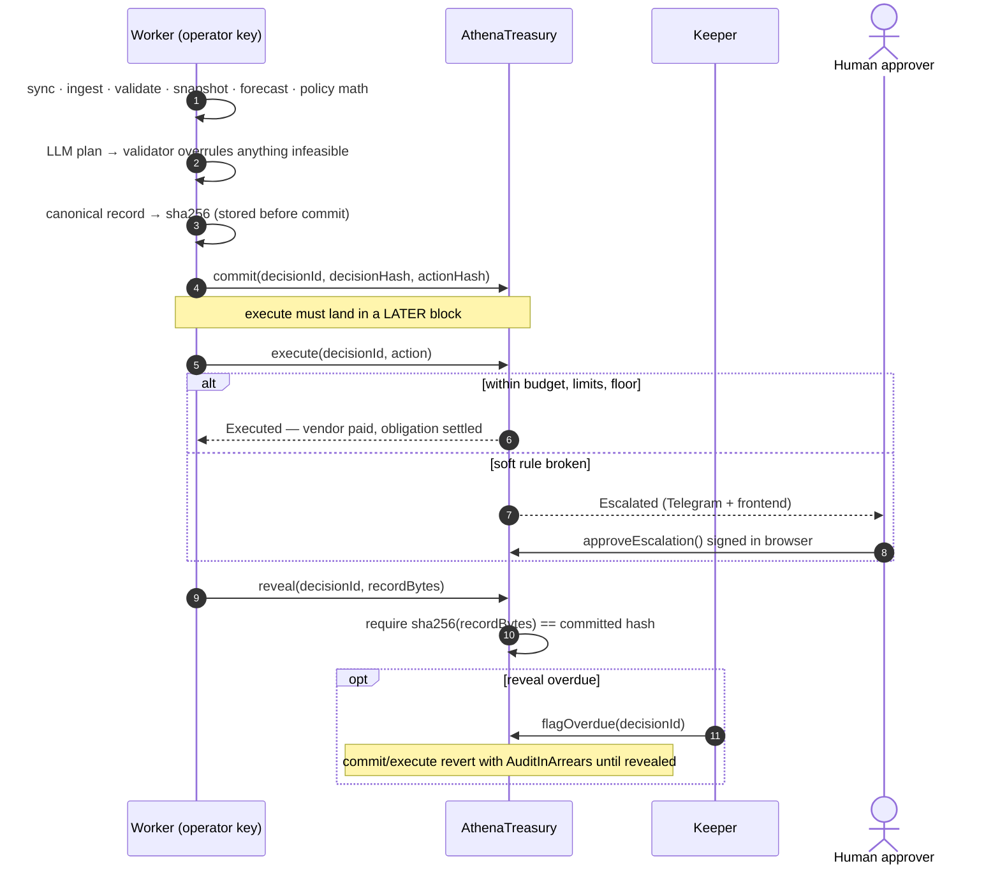

# Athena — Autonomous business treasury on Arc · Tameion Agents Hackathon (Canteen × Circle × Arc)

> Athena runs the financial side of a business as a continuous operation. It holds the company's USDC and EURC in one smart contract where budgets, approval limits, the approved payee list and a minimum operating balance are enforced on-chain. Every decision is **hash-committed before money moves and revealed on-chain afterwards**. An operator that fails to reveal is frozen by the contract.

*Lineage: rebuilt from the Lepton-hackathon streaming broker. The v1 broker/provider/stream code in this repo is legacy and slated for removal (see [Repo structure](#repo-structure)).*

**Deadline: October 17, 2026, 11:59 PM ET.**

---

## One-line problem

An AI agent that reads invoices and posts payments can make the six bookkeeping errors that double-entry accounting does not catch, and today nobody can replay *why* it paid what it paid.

## The problem, in depth

Canteen's essay *Agents and Ledgers in 2026* lists six errors where debits still equal credits afterwards. A model that handles money can make all six, and a prompt-injected invoice, a hallucinated amount or a misread decimal is enough. Worse, a blockchain proves *consistency*, not *independence*: payer and payee read the same record. Athena therefore anchors every vendor payment to an outside document bundle (invoice + purchase order + receipt) whose hash is committed with the payment.

## What Athena does

On every cycle (every 15 minutes, or on an event) the agent:

1. Reads what the business holds: treasury balance, reserve, yield positions, USDC on other chains via Circle Gateway.
2. Reads what it owes and is owed: vendor invoices, contractor milestones, subscriptions, customer receivables.
3. Runs a 30-day cash-flow forecast with a stress case.
4. Decides per obligation: pay now, pay early for a discount, schedule, hold, or send to a human; and how much idle cash goes to yield, and where.
5. **Commits a SHA-256 hash of every decision on-chain before any money moves** (balance seen, forecast run, rule applied, documents matched, payment intended).
6. Executes through the contract, which re-checks every rule.
7. **Reveals the full record on-chain.** The contract recomputes the hash and rejects a mismatch.

The model proposes, deterministic code validates, the contract enforces. The LLM never holds a key and never decides a release.

## The six mistakes and Athena's defense for each

| Error | What it looks like for an agent | Defense | Where |
|---|---|---|---|
| **Omission** | Invoice never paid; payment never matched | Every document becomes a tracked obligation; every inflow must name a registered receivable; unmatched inflows flagged | Phases 17, 20, 35 |
| **Commission** | Paying the account printed on a fraudulent invoice | Payees exist only in an on-chain registry; only the human approver activates them; address changes wait out a cooldown; invoice addresses are compared, never used | Phases 8, 24 |
| **Principle** | Capex booked as a subscription | One category per payee; budgets per category; a payment cannot choose its category | Phases 7, 8 |
| **Original entry** | `6.000000` read as `6.00`; retry pays twice | Strict decimal parser that refuses rather than rounds; deterministic obligation ids; contract refuses to settle an id twice | Phases 3, 10, 22 |
| **Compensating** | Rounding residue quietly booked away | Integer atomic units only; excess decimals refused | Phases 3, 22 |
| **Complete reversal** | Paying a customer instead of collecting | Money leaves only via `execute()` to a registered payee; comes in only via `payReceivable()`/`fund()` — different functions, different roles | Phases 9, 10 |

## Design principles

1. The model plans, the validator checks, the contract enforces.
2. Commit before acting, reveal after acting, get frozen if you don't (including "hold" and "do nothing").
3. Refuse rather than repair: nothing is rounded or fixed quietly.
4. The agent can tighten its own limits, never loosen them.
5. Every vendor payment points at a document (`evidenceHash`).
6. Humans are reached only by contract-created escalations, approved with their own wallet, never by the server.
7. Every write goes through one validated path (API, scheduler and MCP share it).
8. Dry run first: any cycle can run without sending a transaction.

---

## What is used

- **Developer-Controlled Wallets** — FX wallet and house vendors; **Agent Wallets** with spending policies (mainnet purchases).
- **Gateway + x402/Nanopayments** — unified cross-chain balance, consolidation, service purchases, agent-payable receivable links.
- **CCTP V2** — vendors paid natively on other chains (burn inside the treasury contract, attest, mint).
- **App Kit Swap** — USDC ↔ EURC for euro vendors. **Earn Kit** — permissionless yield vaults (optional USYC).
- **Compliance Engine** — screening of payees and customers at onboarding and on a schedule.
- **ERC-8004** — agent identity and reputation (testnet). **Contracts** — `AthenaTreasury.sol`. **USDC and EURC** throughout.
- **Anthropic API** — invoice extraction and the planner (suggestions only). **Supabase** — documents, vendor master, decision mirror.

## How this scores against the judging criteria

| Criterion | Weight | How Athena scores | Phases |
|---|---|---|---|
| Agentic sophistication | 30% | Per-obligation timing (pay now / early-pay / schedule / hold / escalate), prioritization under shortfall, yield vault selection, cross-chain consolidation, FX timing, collections follow-up — each committed with its reasoning before it executes; the contract decides what goes to a human. Not a cron job with an LLM bolted on. | 25–36 |
| Traction | 30% | A scheduled operator settling real recurring obligations for the team's own operations through the whole window; live counters for every RFB 04 metric; automatic Canteen updates; a small set of real **mainnet** payments. | 37, 42–45 |
| Circle tool usage | 20% | DCW, Agent Wallets, Gateway, x402, CCTP V2, App Kit Swap, Earn Kit, Compliance Engine, Contracts, USDC and EURC, optional USYC/Paymaster. | 5, 18, 24, 31–36, 45 |
| Innovation | 20% | Every decision sealed before execution, verified on-chain on reveal, backed by a reveal deadline that freezes the agent if missed — a continuous version of the Athenian *euthyna* audit. The opposite of releasing funds on a model's confidence score. | 10–12, 28–29, 38 |

---

## Architecture

```
                    ┌──────────────────────────────────────────────────────────┐
                    │              ARC (testnet 5042002 / mainnet 5042)        │
 customers ─payReceivable()─►┌────────────────────────────┐                    │
 x402 pay link ─►            │       AthenaTreasury       │─safeTransfer─► vendors (Arc)
 Gateway mint ─►             │ roles · tokens · budgets   │─depositForBurn─► CCTP V2 ─► vendors (Base…)
                    │        │ payee registry + cooldown  │─► yield wallet ─► Earn Kit vaults
                    │        │ commit → execute → reveal  │─► fx wallet ─► App Kit Swap ─► fund()
                    │        │ escalations · reserve      │─► spend wallet ─► Gateway ─► x402 services
                    │        │ audit-arrears breaker      │                    │
                    │        └─────────────┬──────────────┘                    │
                    └──────────────────────┼───────────────────────────────────┘
                                           │ events
                      ┌────────────────────▼─────────────────────┐
                      │ WORKER (Node 22, TS): indexer · snapshot │
                      │ forecast · ingest/extract/match · policy │
                      │ planner · validator · executor/revealer  │
                      │ yield · gateway · cctp relayer · fx · AR │
                      └───────┬──────────────────┬───────────────┘
                              │                  │
                      ┌───────▼──────┐    ┌──────▼────────┐    ┌────────────────┐
                      │ Postgres     │◄───│ API (REST+SSE)│───►│ Frontend       │
                      │ (Supabase)   │    └──────┬────────┘    │ (6 pages)      │
                      └──────────────┘           │             └───────┬────────┘
                                          ┌──────▼───────┐             │ approver signs
                                          │ MCP server   │             ▼ approveEscalation()
                                          │ (read-only)  │       human APPROVER wallet
                                          └──────────────┘
```

**Three processes, one database, one contract.** The *worker* is the only holder of the operator key. The *API* is read-mostly (plus uploads and queued requests) and never holds it. The *MCP server* is a read-only audit lens ("why did Athena pay this early?" from Claude Desktop or Claude Code).

### One treasury cycle



Full 16-step cycle, phase by phase: [BACKEND_README.md](BACKEND_README.md) §A6.

---

## Shared facts — pinned, never re-derive mid-build

Everything reads from `packages/shared/addresses.json`. If something looks stale, re-check the source and update that one file. `null` = not verified yet; code must refuse the feature rather than guess.

| Fact | Testnet | Mainnet |
|---|---|---|
| Chain ID | `5042002` (`0x4cef52`) | `5042` (`0x13b2`) |
| RPC | `arc-canteen rpc-url` (preferred) · `https://rpc.testnet.arc.io` | `https://rpc.mainnet.arc.io` |
| Explorer | `https://explorer.testnet.arc.io` | `https://explorer.arc.io` |
| Faucet | `https://faucet.circle.com` | — |
| CCTP domain | `26` | `26` |
| USDC (ERC-20, **6 dec**) | `0x3600000000000000000000000000000000000000` | same |
| EURC (6 dec) | `0x89B50855Aa3bE2F677cD6303Cec089B5F319D72a` | `0xbEf5f6d51CB62b58e6A8f77868681825C6fe21c1` |
| USYC (optional) | `0xe9185F0c5F296Ed1797AaE4238D26CCaBEadb86C` | `0x8a5D989Bbb96929F689B0200f435f53dA42bF490` |
| CCTP TokenMessengerV2 | `0x8FE6B999Dc680CcFDD5Bf7EB0974218be2542DAA` | `0x28b5a0e9C621a5BadaA536219b3a228C8168cf5d` |
| CCTP MessageTransmitterV2 | `0xE737e5cEBEEBa77EFE34D4aa090756590b1CE275` | `0x81D40F21F12A8F0E3252Bccb954D722d4c464B64` |
| Gateway Wallet | `0x0077777d7EBA4688BDeF3E311b846F25870A19B9` | `0x77777777Dcc4d5A8B6E418Fd04D8997ef11000eE` |
| Gateway Minter | `0x0022222ABE238Cc2C7Bb1f21003F0a260052475B` | `0x2222222d7164433c4C09B0b0D809a9b52C04C205` |
| ERC-8004 Identity / Reputation | `0x8004A818BFB912233c491871b3d84c89A494BD9e` / `0x8004B663056A597Dffe9eCcC1965A193B7388713` | not verified — feature off |
| Gateway API / x402 facilitator | `https://gateway-api-testnet.circle.com` (`eip155:5042002`) | ⚠️ verify (middleware default is mainnet) |
| CCTP attestation (Iris v2) | `https://iris-api-sandbox.circle.com` | `https://iris-api.circle.com` |
| Compliance Engine | `https://api.circle.com/v1/w3s/compliance/screening/addresses` | same host, mainnet chain codes |

CCTP destination domains: Ethereum/Sepolia `0` · Avalanche `1` · OP `2` · Arbitrum `3` · Base/Base Sepolia `6` · Polygon `7` · Arc `26`. Full tables incl. USYC Teller/Entitlements/Oracle: [BACKEND_README.md](BACKEND_README.md) §A7.

⚠️ Old material uses `rpc.testnet.arc.network` and `testnet.arcscan.app`. Current docs use the `arc.io` domains above; old URLs are aliases — don't hardcode them. Never commit an RPC URL that embeds an auth token (the v1 `shared/addresses.json` did).

⚠️ **USDC decimals rule:** every budget, invoice, payment and forecast is the **6-decimal ERC-20** value in integer atomic units (`1 USDC = 1_000_000`). The 18-decimal native interface is gas only. A number off by ~10¹² means you read the native balance.

⚠️ **`anvil` is not Arc.** It can't reproduce native-coin precompiles, blocklist enforcement or EIP-7708 logs. Unit tests on `anvil`; integration tests on the real Arc RPC.

⚠️ **Arc quirks:** order with `block.number`, measure periods with `block.timestamp` (1-second granularity); `PREVRANDAO` is always `0`; finality is immediate (no reorg handling); transfers to/from blocklisted addresses revert, so Athena pays one vendor per transaction.

⚠️ **`circle services pay` has no loop mode** — one payment per call. Programmatic buying uses `GatewayClient` from `@circle-fin/x402-batching/client`, and the x402 middleware's `facilitatorUrl` must be set explicitly on testnet.

## Wallet and key topology

Every key has one job. The backend never holds the admin or approver keys, and the contract refuses to give the operator role to an admin/approver address (or vice versa).

| Key | Type | Held by | Can | Cannot |
|---|---|---|---|---|
| Admin | Human (hardware/multisig) | A person | Deploy, budgets, limits, tokens, raise caps, unpause | Anything automated |
| Approver | Human, ≠ admin | A person, in the frontend | Activate payees, approve/reject escalations, suspend, pause | Run cycles |
| Operator | EOA | Worker | Commit, execute, cancel, propose payees, tighten caps, register receivables | Activate payees, approve, change budgets, unpause |
| Keeper | EOA | Separate process | `flagOverdue` | Anything with money |
| Yield / Spend / Collections | EOAs | Worker | Earn Kit vaults / Gateway + x402 purchases / x402 seller + `payReceivable` | Receive more than their budget allows |
| FX | Circle DCW | Circle | App Kit swap, `fund()` EURC back | Exceed the FX budget |
| Validator | EOA | Worker | ERC-8004 feedback | Anything with money |
| Relayer | EOA on destination chains | Worker | CCTP `receiveMessage` | Anything on Arc |

Yield, spend and FX wallets are themselves registered payees (`YIELD`, `SERVICES`, `FX` categories), so moving money into them is an ordinary committed, policy-checked payment.

---

## Frontend — six pages

Carried over from v1: landing page (`/`), Nav, layout, global styles, `lib/wagmi.ts` (add Arc Testnet, chain ID `5042002`). Replaced: `lib/api.ts` and the dashboard/stream/agents/evidence/live pages.

| # | Page | What it shows | Wallet actions |
|---|---|---|---|
| 1 | **Dashboard** `/dashboard` | USDC/EURC balances (reserved/free/floor), runway, budget bars per category, last cycle status, run/dry-run buttons, live SSE event feed | — |
| 2 | **Obligations** `/obligations` | Tab *Payables*: AP obligations, status, planned date, decision link, detail with 3-way match + evidence bundle. Tab *Review Queue*: held invoices (duplicates, mismatches, unknown vendors, address changes) | Approver resolves held invoices with an **EIP-191 signature** |
| 3 | **Audit Trail** `/decisions` | Commit/reveal log, newest first; detail with the full record JSON, tx links, and a **verify panel** (`/decisions/:id/verify`) showing the SHA-256 match against the chain | — |
| 4 | **Approvals** `/approvals` | Tab *Escalations*: pending contract-level escalations with record and proposed action. Tab *Payees*: vendor master, status, cap, risk tier, scorecard, address history | Approver signs `approveEscalation` / `approvePayee` **directly on the contract** |
| 5 | **Receivables** `/receivables` | AR list with dunning stage, issue new receivable. Public `/pay/[receivableId]` page for customers | Customer connects wallet → `approve` + `payReceivable` |
| 6 | **Metrics** `/metrics` | All traction numbers (mainnet first), daily series, yield vaults/positions, cross-chain transfer stages (burn → attest → mint) | — |

Rules: **no endpoint moves treasury money** — the frontend only reads, uploads, queues, or relays an approver wallet signature on an already-committed decision. All amounts arrive as strings of atomic units; the UI divides by `1_000_000`. One SSE client on `GET /events/stream` drives live updates across pages. Detail: [FRONTEND_README.md](FRONTEND_README.md).

## API surface (port 3100)

| Page | Endpoints |
|---|---|
| Dashboard | `GET /health` (adds `lastCycleAt`, `paused`, `overdueCount`) · `GET /treasury/overview` · `GET /treasury/forecast` · `GET /events/stream` (SSE via Postgres LISTEN/NOTIFY) · `POST /admin/cycle/run` · `POST /admin/cycle/dry-run` |
| Obligations | `GET /obligations?status=` · `GET /obligations/:id` · `GET /invoices?status=held` · `GET /invoices/:id` · `POST /invoices/upload` (multipart, LLM extraction) · `POST /invoices/:id/resolve` (EIP-191) |
| Audit Trail | `GET /decisions?kind=&state=` · `GET /decisions/:id` · `GET /decisions/:id/verify` · `GET /cycles` · `POST /decisions/:id/review` |
| Approvals | `GET /escalations?status=pending` · `GET /escalations/:id` · `GET /payees` · `GET /payees/:id` · `POST /payees` (draft + screening) |
| Receivables | `GET /receivables` · `GET /receivables/:id` · `POST /receivables` (registers on-chain) · `GET /pay/:receivableId` (x402 link) |
| Metrics | `GET /metrics` · `GET /yield/vaults` · `GET /yield/positions` · `GET /crosschain` |

Kept from v1: `GET /logs`, `GET /compliance/:address`, `GET /system-health`. Replaced: the broker, provider agents, stream loop, MCP quality monitor and `AthenaCommit.sol`. Contract-signed actions (`approveEscalation`, `approvePayee`) need no backend endpoint, but the indexer must ingest `DecisionEscalated` and `PayeeProposed` to populate the tables. Full list: [BACKEND_README.md](BACKEND_README.md) Phase 40.

## Documents in this repo

| File | Covers |
|---|---|
| `README.md` | This file — index, pitch, shared facts, roadmap, submission |
| `BACKEND_README.md` | Phases 0–47: contract, worker, AP/AR, decision engine, yield, cross-chain, API, MCP, metrics, mainnet, troubleshooting |
| `FRONTEND_README.md` | The six pages, state, SSE, wallet flows |
| `backend/README.md` | **Legacy v1** (broker/stream) — to be removed |

---

## Repo structure

Target layout (`pnpm` workspaces):

```
athena/
├── packages/
│   ├── contracts/      Foundry: AthenaTreasury.sol, ITokenMessengerV2, tests, Deploy/Configure scripts
│   └── shared/         addresses.json, abis/, money.ts, ids.ts, canonical.ts, action.ts, categories.ts
├── apps/
│   ├── backend/        worker.ts + api.ts: indexer, snapshot, forecast, ingest, validate, payees,
│   │                   policy, planner, decisions, escalations, yield, gateway, cctp, fx, ar,
│   │                   services, reputation, metrics, cycle, keeper
│   └── mcp/            read-only audit MCP server
├── supabase/migrations/
├── scripts/            wallets/ seed/ scenarios/ traction/
└── frontend/           Next.js (6 pages)
```

**Current state:** the tree is still v1 — `backend/` (broker, providers, stream loop, MCP monitor, CCTP payout), `contracts/` (`AthenaCommit.sol`), `shared/`, `frontend/`. Migrating to the layout above is the first build task; only `GET /logs`, `/compliance/:address`, `/system-health`, the landing page, Nav, layout and `lib/wagmi.ts` carry over.

## Build roadmap

Each phase ends with an exit check; don't start the next until it passes. Detail in [BACKEND_README.md](BACKEND_README.md).

| Block | Phases | Outcome |
|---|---|---|
| Foundations | 0–5 | Accounts/tools, monorepo, addresses, shared money/hash code, DB schema, wallets |
| The contract | 6–13 | Roles, budgets + floor, payee registry, receivables, commit/execute/reveal, escalations, audit breaker, CCTP |
| Tests + deploy | 14–15 | Full Foundry suite (one test per bookkeeping error, invariants), deploy, verify, TS↔Solidity hash parity |
| Chain + knowing the money | 16–19 | Config, indexer, snapshot, forecast |
| Accounts payable | 20–24 | Intake, LLM extraction (suggestion only), strict decimals, duplicates, 3-way match, payee onboarding/screening |
| Decision engine | 25–30 | Policy math, planner, validator, decision records, execute/reveal/recover, escalations |
| Moving money well | 31–34 | Yield (Earn Kit), Gateway, CCTP relayer, EURC swaps |
| AR + services | 35–36 | Receivables, dunning, x402 pay links, service purchases + independent metering |
| Running continuously | 37–39 | Cycle orchestrator, keeper, vendor reputation + ERC-8004 |
| Surfaces | 40–41 | REST + SSE, MCP server |
| Traction + proof | 42–44 | Metrics + Canteen updates, house operations seed, 15 scenarios |
| Mainnet + submit | 45–47 | Small real mainnet operation, production deploy, submission |

## Handoffs

| # | From → To | What |
|---|---|---|
| H1 | Contract → Backend + Frontend | `AthenaTreasury` ABI exported to `packages/shared/abis`, deployed address + deploy block in `addresses.json` |
| H2 | Contract → Backend | Hash parity (`actionHash`, SHA-256 record) passes against the live contract |
| H3 | Backend → Frontend | OpenAPI file + stable response shapes (amounts as atomic-unit strings) |
| H4 | Backend → Frontend | SSE event types: `cycle.step`, `decision.*`, `escalation.resolved`, `invoice.held`, `payment.in`, `crosschain.stage`, `audit.arrears` |
| H5 | Frontend ↔ Contract | Approver wallet flows (`approvePayee`, `approveEscalation`) and customer `payReceivable` against the deployed ABI |
| H6 | All | Phase 43 seed running; first escalation approved from the UI end to end |
| H7 | All | Scenarios S1–S15 pass; hashes written to `docs/scenarios.md` |

Blocked on a handoff? Say so immediately — silent waiting is the #1 team-killer.

## Mainnet scope and honest labeling

Small and real: same contract with mainnet addresses, funded ≤ 25 USDC, every budget ≤ 10 USDC, approval limit 2 USDC, payee cooldown 24 h, a hardware-wallet admin, one real vendor payment, one real receivable, one real Circle Agent Marketplace purchase, keeper running. Earn Kit, Gateway consolidation and ERC-8004 stay off on mainnet until their addresses/endpoints are verified.

Traction is reported plainly: Athena operates **the team's own operations** ("N vendors, M customers"); testnet yield is labeled testnet; scenario runs are tagged `scenario` and excluded from operating totals.

## Known limits

- The chain proves consistency, not independence — the evidence hash only helps if someone holds the documents (they are stored and downloadable).
- A compromised operator key can still pay approved payees within limits until a human pauses or revokes; limits, cooldown, evidence requirement, reveal deadline and human-only payee activation bound the damage.
- An unavailable compliance screen never counts as a pass.

## Quick troubleshooting

| Symptom | Likely cause |
|---|---|
| Amount off by ~10¹² | Read native 18-decimal balance instead of the 6-decimal ERC-20 |
| `CommitNotSettled` | `execute` sent in the same block as `commit` |
| `ActionMismatch` / `HashMismatch` | Executed/revealed something other than the exact stored action/bytes — reveal `record_bytes` as stored; run the parity test |
| `AuditInArrears` | A record wasn't revealed in time — run recovery, reveal, find out why reveals stopped |
| x402 "No Gateway batching option for eip155:5042002" | Middleware `facilitatorUrl` defaulted to mainnet |
| Blocked on a payment | `PayeeCoolingDown`/`PayeeNotActive` — expected; the obligation re-plans |

More in [BACKEND_README.md](BACKEND_README.md) Part C.

## Submission checklist

- [ ] Register on Luma: `https://luma.com/ivroypr5` (passphrase in BACKEND_README Phase 0) with exact GitHub + Discord handles
- [ ] Join Canteen Discord `https://discord.gg/bDaEfsSqc8` and Arc builder Discord `https://discord.com/invite/buildonarc` (mention Canteen + Tameion)
- [ ] Install Canteen CLI (`uv tool install git+https://github.com/the-canteen-dev/ARC-cli`) and Circle CLI (`npm install -g @circle-fin/cli`)
- [ ] Public GitHub repo with this README, BACKEND/FRONTEND READMEs, `docs/scenarios.md`, `docs/traction/`
- [ ] Contract verified on both explorers; live frontend + API URLs
- [ ] Log traction/product regularly: `arc-canteen update traction` · `arc-canteen update product`
- [ ] Demo video under 3 minutes (Loom/YouTube/Vimeo)
- [ ] Submit `https://forms.gle/BBWrdfuircrKiG2i6` before **Oct 17, 11:59 PM ET** (resubmit after each improvement)
- [ ] Submit Circle product feedback (specific, reproducible)
